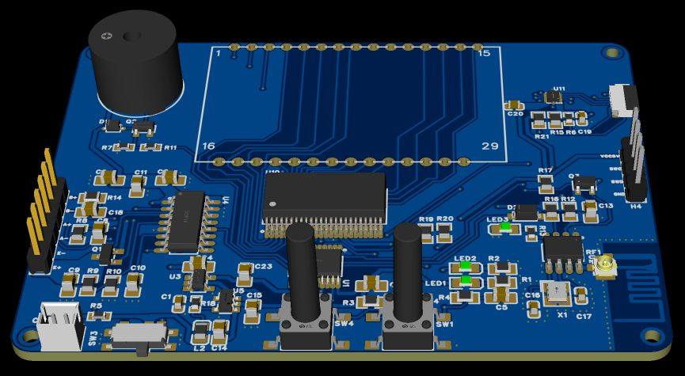

# 5kg 厨房电子秤 · PY32F002A

**v2.4.3：SW4 双击确认、空秤追零、毛重与净重切换、两节电池电量。** 默认 20 g 单点标定、空盘无操作 120 秒待机。板上 14 项菜单支持日常设置和维护。

开发环境：**VS Code + PlatformIO + C / 普冉HAL**。仓库包含源码、板型、链接脚本、固定依赖、下载脚本、原理图、需求文档、操作指南、蓝牙客户端和固件。



## 先操作起来

| SW4在称重页的操作 | 功能 |
|---|---|
| 短按 | 稳定去皮 |
| 双击 | 空盘归零并清除皮重 |
| 按住约2秒松开 | 进入设置 |
| 待机时按一下 | 唤醒，重新采样 |

设置内短按切换，双击进入或保存，长按退出。01 切毛重和净重，02 切 g 和 kg。数字编辑短按加一，约2秒长按换位，双击确认，至少3秒长按取消。

**[完整操作指南：14项菜单、20g标定、电源与蓝牙](docs/button-guide.md)**

## 功能

- 当前示值在 ±1 g 内显示零，超过 1 g 恢复正常称重。20 g 标定后用 10 g 砝码独立复验。
- 5000g容量、5250g超载；按毛重保护，支持负净重，采用0.1/0.5/1g分段分度。
- 去皮、归零及标定在松手800ms后采16个新读数。1～3点标定，默认1点20g；卸载检查通过后整体保存。
- 04提供0、30、60、120、300、600秒待机档。11查看两节碱性电池估算电量与电压。12切换5位和6位显示，默认5位绕过已知缺段位。
- 静音、提示音、标定日期、设备信息、屏幕自检、待机、蓝牙开关和恢复默认。
- 双页CRC参数存储，旧标定迁移、写入验证、坏页回退。
- BLE 5Hz重量、去皮、状态同步、心跳与唤醒。浏览器显示实时重量、单位、皮重、电量和状态。

## 1. 下载与构建

安装[VS Code](https://code.visualstudio.com/)、[Git](https://git-scm.com/downloads)及VS Code扩展PlatformIO IDE、C/C++。

```powershell
git clone https://github.com/lin-gengyou/py32-kitchen-scale.git
cd py32-kitchen-scale
code .
```

在VS Code执行 **PlatformIO: New Terminal**：

```powershell
python tools/setup_pack.py
pio run
```

默认构建完整固件scale_basic。Upload会自动准备芯片包。平台、HAL、GCC和DFP版本见[依赖](docs/third-party.md)。

| PIO环境 | 内容 | 烧录器 |
|---|---|---|
| scale_basic | 全部称重/按键/LCD/BLE功能，默认 | PWLINK2 Lite / CMSIS-DAP |
| scale_basic_jlink | 同一份完整固件 | ARM V9 / J-Link |
| scale_py32f002a | 点灯诊断，LED2每500ms翻转 | CMSIS-DAP |
| scale_py32f002a_jlink | 同一点灯固件 | J-Link |

Windows普通PowerShell可直接调用 `& "$env:USERPROFILE/.platformio/penv/Scripts/pio.exe" run`。完整固件16352B Flash、2168B RAM（含向量表与预留堆栈），程序上限16KB、总RAM3KB；末尾4KB为独立配置区。编译采用GCC14的Oz、LTO和小函数内联限制。

## 2. 接线与烧录

秤板使用自身电源。PWLINK2 Lite先在[PowerWriter客户端](https://www.powerwriter.com/index/index/products.html?c=files&p=&t=Client)选择接口电平→外部输入→应用→保存全局上电设置，再断电接线。

从屏幕端向板外侧数H4：

| 位置 | 主板 | 烧录器 |
|---|---|---|
| 第1根 / H4-4 | VCC5V | VREF/TVCC参考输入 |
| 第2根 / H4-3 | PA14 | SWCLK |
| 第3根 / H4-2 | PA13 | SWDIO |
| 第4根 / H4-1 | GND | GND |

烧录器独立电源输出脚空置。ARM V9按[烧录说明](docs/upload-troubleshooting.md)处理内部Vtref/VOUT短接。完整PCB定位见[硬件说明](docs/hardware.md)。

```powershell
# PWLINK2 Lite
pio run -e scale_basic -t upload
# 队友的J-Link
pio run -e scale_basic_jlink -t upload
```

也可在PlatformIO → Project Tasks → 对应环境点Build/Upload。下载使用Puya DFP、100kHz SWD、扇区擦除，保留独立配置区。完成后复位运行，LCD先自检再显示2.4.3。

## 3. 20g标定与第一次称重

1. SW4长按约2秒松开，短按四次到05，双击进入。
2. 保留默认点数1，双击确认。清空秤盘，在ZERO页双击并等WAIT结束。
3. 双击确认默认质量20g。放上20g砝码，在C1g页双击并等待。
4. 出现End/ZERO后取走砝码，双击。出现SAvEd表示保存。
5. 空秤核对0.0g，复放砝码核对重量。平时空盘双击SW4可重新归零。

20g用于低量程标定。两点/三点标定支持在菜单05编辑递增的质量。日常去皮时先放空容器，短按SW4，再加物品。

## 4. 蓝牙客户端

仓库根目录运行：

```powershell
python -m http.server 8765 --directory web --bind 127.0.0.1
```

在Chrome/Edge打开 **http://localhost:8765**，点“连接蓝牙秤”，选择BT_设备。显示稳定后可远端去皮；断线自动重新发现服务并订阅。页面也提供明确标识的演示模式。

服务FFF0，FFF1通知、FFF2写入，MCU USART1为9600/8N1。电量以两节碱性电池的电压估算，采样等待或异常时battery=-1。Android平板通过支持Web Bluetooth的Chrome及HTTPS地址使用；原生应用可按[完整蓝牙协议](docs/protocol.md)接入。

## 5. 更新与现成固件

```powershell
git pull --ff-only
pio run -e scale_basic -t upload
```

当前文件：[firmware/v2.4.3](firmware/v2.4.3)，对应[GitHub Release](https://github.com/lin-gengyou/py32-kitchen-scale/releases/tag/v2.4.3)。

- scale_basic.hex / .elf包含地址；scale_basic.bin起始地址0x08000000。
- blink.*为点灯诊断；SHA256SUMS核对固件，manifest.json核对源码。
- 当前操作使用v2.4.3指南。

## 6. 彩屏怎么用

彩屏规划为“重量主界面＋20g标定向导＋完整设置＋故障说明”，与段码屏共用SW4及称重状态。客户端服务启动后打开 **http://localhost:8765/tft-preview.html** 体验界面。接口、分块刷新、共享总线和字库方案见[彩屏设计](docs/color-display.md)。当前屏幕控制器型号待确认，发布固件主显示使用段码LCD。

## 7. 代码入口与检查

| 文件 | 内容 |
|---|---|
| src/scale_basic.c | HX711、滤波、换算、去皮归零、待机、报警与调度 |
| src/scale_ui.inc | 实体键、14菜单、数字编辑、原子标定向导 |
| src/lcd_ht1621.c | PCB段映射、5/6位布局、负号与实际RAM读回 |
| src/battery.c | PB1/内部参考、异步ADC、电源类型、百分比与低电滞回 |
| src/ble_link.c | USART中断缓冲、ASCII协议、去重、无交错发送 |
| src/scale_config.c | 双页CRC、范围校验、V1/V2迁移 |
| web/ | 终端客户端、纯协议、彩屏预览 |
| tests/host/、tests/web/ | 逐沿HX711协议、固件逻辑、实测回放、存储截断与协议回归 |
| tests/fixtures/ | 已确认空秤的相对时间/ADC计数测试输入 |

```powershell
python tools/run_host_checks.py
node --test tests/web/protocol.test.mjs
pio run -e scale_py32f002a -e scale_basic -e scale_py32f002a_jlink -e scale_basic_jlink
python tools/package_firmware.py --version v2.4.3
```

Windows主机检查可加 `--cc C:/msys64/ucrt64/bin/gcc.exe`。已覆盖合成8小时蓝牙/24小时称重调度；整机精度、偏载、漂移与无线长测按[需求对照](REQUIREMENTS.md)逐项测量。20g单点完成当前校准流程，大量程精度使用对应质量标准砝码检验。

[用户说明书 PDF](docs/manuals/厨房电子秤_用户说明书.pdf) · [技术示意图 PDF](docs/manuals/厨房电子秤_技术示意图.pdf)

[固件设计与软件验收](docs/firmware-design.md) · [全部操作](docs/button-guide.md) · [需求](REQUIREMENTS.md) · [版本变更](CHANGELOG.md) · [团队开发](docs/team-workflow.md) · [段码定位](docs/lcd-mapping.md)
