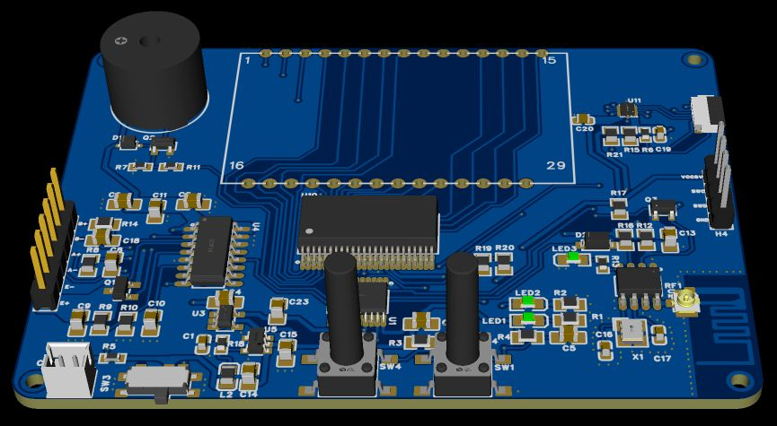

# 5kg 厨房电子秤 · PY32F002A

基于 **PY32F002AF15P6TU + HX711 + ECB01C** 的电子秤固件，使用 **VS Code + PlatformIO + C / 普冉 HAL** 开发。当前固件版本 **1.0.2**，蓝牙应用协议版本 **2**。

本仓库包含项目源码、自定义板型、链接脚本、构建与下载脚本、桌面模拟检查、固件文件、原理图和项目文档。编译器、SDK 与芯片包按固定版本安装。



## 先看哪份资料

| 你要做的事 | 从这里开始 |
|---|---|
| 第一次拿到项目，完成编译、接线、烧录 | 阅读本页第 1～5 节 |
| 操作实物、标定、查看全部功能 | [PCB 操作与联调指南 PDF · 29 页](docs/manuals/02_厨房电子秤PCB操作与联调指南_1.0.2.pdf) |
| 对照源码理解每部分逻辑 | [功能逻辑与代码图解 PDF · 43 页](docs/manuals/01_厨房电子秤功能逻辑与代码图解_1.0.2.pdf) |
| 写手机或 RK3566 平板端程序 | [蓝牙与串口协议](docs/protocol.md) |
| 查针脚、电源、屏幕与传感器连接 | [硬件连接说明](docs/hardware.md) |
| 分工、修改代码、提交给队友 | [团队协作流程](docs/team-workflow.md) |
| 看当前需求与功能进度 | [需求对照](REQUIREMENTS.md) |

## 1. 下载项目并准备开发环境

Windows 上安装 [Git](https://git-scm.com/downloads) 和 [VS Code](https://code.visualstudio.com/)。在 VS Code 扩展面板安装 **PlatformIO IDE** 与 **C/C++**。

### 方式 A：用 Git 下载，方便后续更新

```powershell
git clone https://github.com/lin-gengyou/py32-kitchen-scale.git
cd py32-kitchen-scale
code .
```

### 方式 B：下载 ZIP

在仓库页面选择 **Code → Download ZIP**，解压后在 VS Code 中打开含有 `platformio.ini` 的文件夹。

首次打开后等待 PlatformIO 初始化。终端通过 **PlatformIO: New Terminal** 或 **PlatformIO Core CLI** 打开。以下 `pio` 和 `python` 命令均在该终端、项目根目录执行。

```powershell
pio --version
python tools/setup_pack.py
```

第二条命令下载普冉 DFP **1.2.20**，核对 SHA-256，保存为 `packs/Puya.PY32F0xx_DFP.1.2.20.pack`。已有正确版本时直接复用。工程使用 PlatformIO Core **6.1.19** 验证；平台、HAL 和 ARM GCC 的固定版本见 `platformio.ini`。

Windows 普通 PowerShell 也可直接调用 PlatformIO 自带程序：

```powershell
$pio = "$env:USERPROFILE/.platformio/penv/Scripts/pio.exe"
$pioPython = "$env:USERPROFILE/.platformio/penv/Scripts/python.exe"
& $pioPython tools/setup_pack.py
& $pio run -e scale_basic
```

## 2. 选择编译目标

| PlatformIO 环境 | 用途 | 成功后的行为 |
|---|---|---|
| `scale_py32f002a` | 首次点灯、检查下载链路；也是默认环境 | LED2 每 500ms 翻转一次，完整亮灭周期约 1 秒 |
| `scale_basic` | 完整称重与控制固件 | HX711 采样、标定、去皮归零、蓝牙协议、蜂鸣、待机和参数保存 |

```powershell
pio run -e scale_py32f002a
pio run -e scale_basic
```

在 VS Code 左侧 PlatformIO 图标 → **Project Tasks** 中，也可以分别展开两个环境，点击 **Build**。输出末尾出现 `SUCCESS` 表示该目标构建完成。固件生成在 `.pio/build/<环境名>/firmware.elf`。

当前两个目标的构建记录：

| 目标 | Flash | RAM（含链接器预留堆栈） |
|---|---:|---:|
| 点灯 | 1660 B / 16384 B | 1008 B / 3072 B |
| 称重 | 14632 B / 16384 B | 2104 B / 3072 B |

## 3. 连接烧录器和秤板

使用 **支持 5V 目标 SWD 电平的烧录器**。pyOCD统一对接CMSIS-DAP和安装驱动后的J-Link；PWLINK2 Lite使用目标电压参考模式。秤板由自身电源供电，烧录器使用USB连接电脑。

PWLINK2 Lite 在 PowerWriter 客户端中先选择 **接口电平 → 外部输入 → 应用 → 保存全局上电设置**。完成设置后断电接四线，再给秤板供电。烧录器的专用 5V 供电输出脚在此连接方式中保持空置。

H4 的 VCC5V 给烧录器提供目标电压参考。主控以 5V 工作时，输入高电平保证值为 `0.7 × VCC = 3.5V`；烧录器的 SWD 信号使用对应的目标电平。[主控数据手册第 42 页](https://www.puyasemi.com/download_path/数据手册/MCU%20微处理器/PY32F002A系列数据手册_V1.1.pdf#page=42)

更详细的针脚、H1 传感器接口和 FPC 定义见 [硬件连接说明](docs/hardware.md)。

**ARM V9 / J-Link类下载器**：这款外壳贴纸标注VOUT=3.3V，Vtref与VOUT出厂默认内部短接。先断电，按厂家说明断开这个内部短接，再把秤板5V接Vtref参考输入；VOUT和19脚5V输出保持空置。分步接线、测量与诊断见 [ARM V9 首次连接](docs/upload-troubleshooting.md)。

## 4. 烧录与首次点灯

1. 完成芯片包下载和 H4 四线连接，给秤板上电。
2. 关闭占用烧录器的其他下载软件。
3. 下载点灯目标，查看擦写、校验和复位结果。

```powershell
pio run -e scale_py32f002a -t upload
```

4. 观察 LED2 按 500ms 翻转。LED1 对应电源支路。
5. 下载称重目标。

```powershell
pio run -e scale_basic -t upload
```

上传使用pyOCD、目标`py32f002ax5`、默认**100kHz SWD**、扇区擦除和软件复位，并输出详细连接日志。速度由`platformio.ini`的`custom_swd_frequency`设置。外部供电时配置`jlink.power=false`，上传过程保持J-Link目标供电请求关闭。CMSIS-DAP与J-Link上传使用USB调试接口，串口COM号用于UART调试。

J-Link同时设置`jlink.non_interactive=false`，允许SDK显示对话框，跳过pyOCD 0.36在打开设备前关闭弹窗的调用。这用于规避J-Link DLL 9.14及以上版本的已知打开顺序问题，详见[上游修复说明](https://github.com/pyocd/pyOCD/pull/1927)。

正常上传保留最后 4KB 配置扇区。整片擦除后，重新执行第 6 节标定。

连接诊断在PlatformIO终端运行：

```powershell
python tools/swd_diagnose.py --uid jlink:
```

CMSIS-DAP可运行`python tools/swd_diagnose.py`。脚本先列出下载器，再以100kHz连接并读取CPUID、RAM和Flash开头，将详细结果写入`logs/swd-*.log`。诊断会暂停内核，结束后按SW1复位恢复运行。上传时的日志可保存为：

```powershell
pio run -v -e scale_py32f002a -t upload 2>&1 | Tee-Object upload.log
```

## 5. 接入称重传感器并查看数据

程序使用 HX711 **A 通道、128 倍增益**。四线全桥传感器按厂家给定的 E+、E−、A+、A− 接到 H1：

| H1 针号 | 连接 |
|---|---|
| 3 | A+ 信号正端 |
| 4 | A− 信号负端 |
| 5 | E+ 激励正端 |
| 6 | E− 激励负端 |
| 1、2 | B+、B−，本版使用 A 通道 |

传感器固定端、受力端及秤盘按单点梁安装资料装配。安装后把秤放在水平硬质台面。

用手机 BLE 调试工具或 RK3566 应用扫描并连接 ECB01C，发现服务后订阅 **FFF1 Notify**，向 **FFF2 Write** 发送 ASCII 文本，行尾选择 **CRLF**。主控和 ECB01C 之间的 UART 配置为 **9600bps、8N1**。

先逐条发送以下命令，每条收到完整应答后再发送下一条：

```text
STREAM 0
INFO
STATUS
RAW
```

- `INFO`：检查 `FW=1.0.2`、`PROTO=2` 和设备信息。
- `STATUS`：查看 `READY`、`STABLE`、`CAL_POINTS` 等字段。
- `RAW`：查看 ADC 原始计数，加载时计数随受力变化。
- `STREAM 0`：暂停周期上报，方便观察命令应答。

## 6. 完成空秤确认和三点标定

以下砝码数值都指 **秤台上总质量**。先保持空秤，查询 `STATUS`，等到 `READY=1`、`STABLE=1`。

| 步骤 | 实物操作 | 命令 | 成功应答 |
|---|---|---|---|
| 1 | 初次标定或更换传感器 | `CALRESET` | `OK,CALRESET` |
| 2 | 空秤，重新等待稳定 | `ZERO` | `OK,ZERO` |
| 3 | 加载总质量 500g，等待稳定 | `CAL 500` | `OK,CAL,SAVED` |
| 4 | 调整为总质量 2500g，等待稳定 | `CAL 2500` | `OK,CAL,SAVED` |
| 5 | 调整为总质量 5000g，等待稳定 | `CAL 5000` | `OK,CAL,SAVED` |
| 6 | 移走砝码 | `STATUS`、`READ` | `CAL_POINTS=3`，查看空秤读数 |
| 7 | 录入实际设备编号和日期 | `DEVICE SCALE-001`、`CALDATE 20261105` | `OK,DEVICE`、`OK,CALDATE` |
| 8 | 恢复周期数据 | `STREAM 1` | `OK,STREAM` |

设备编号和日期按实际标定记录填写。每个点成功后自动保存。重新录入相同或更小质量点时，从该点开始补录后续点。

标定后使用低段、中段和高段砝码检查上升、下降、重复性与偏载。测试项目和记录内容见 [需求对照](REQUIREMENTS.md) 与操作指南第 27 页。

## 7. 日常操作与完整功能

| 操作 | 使用方式 | 结果 |
|---|---|---|
| 称重 | 放入物体，读取 FFF1 的 `W` 帧 | 输出净重、稳定标志、皮重和状态 |
| 去皮 | 放容器，稳定后短按 SW4 并松开；或发送 `TARE,42` | 当前容器作为皮重，净重归零 |
| 取消去皮 | `UNTARE` | 皮重清零，恢复毛重关系 |
| 空秤归零 | 移走负载，稳定后长按 SW4 至 1.5s；或 `ZERO` | 更新运行零点并清皮重，保留标定曲线 |
| 负重量 | 去皮后取走容器 | 保留负净重 |
| 修改单位 | `UNIT g` / `UNIT kg` | 保存显示单位到统一重量状态；协议重量单位为 g |
| 修改判稳阈值 | `STABLE 64` | 以 ADC 计数设置 8 点窗口峰峰值阈值，保存后重建窗口 |
| 提示音 | `BUZZER ACTIVE` / `BUZZER PASSIVE` / `BUZZER OFF` | 保存有源 / 无源约 500Hz / 静音模式 |
| 修改上报速度 | `RATE 100` / `RATE 200` | 每 100ms / 200ms 上报，分别为 10Hz / 5Hz |
| 暂停 / 恢复上报 | `STREAM 0` / `STREAM 1` | 控制周期消息，采样与控制任务继续运行 |
| 自动待机 | `AUTO_OFF 120` | 空秤稳定且无操作 120 秒后软件待机 |
| 关闭自动待机 | `AUTO_OFF 0` | 保持活动运行 |
| 唤醒 | 待机时按 SW4 或发送 `WAKE` | 恢复 HX711 采样，先进入 `WAIT` |
| 主控复位 | 按 SW1 | 恢复 Flash 中的配置，重新采样 |

去皮和归零要求采样新鲜且稳定。已标定时，归零接受空秤基线附近 ±0.1g 的毛重；0.5g 等小负载保留为真实重量。5kg 上限按包含容器的毛重检查。

蜂鸣器新设备配置为 `OFF`，按板上器件类型选择 `ACTIVE` 或 `PASSIVE`。普通控制/设置成功响一声、错误响三声；带序号去皮对同一请求只响一次；持续故障每 2 秒三声提醒。

软件待机时 HX711 掉电、LED2 和蜂鸣器输出关闭，MCU 保留按键与串口任务。唤醒用的这一次按键只唤醒，下一次短按再执行去皮。接收下行命令会重新计算无操作时间，测试自动待机时使用设备主动上报来观察。

## 8. 读懂重量帧，编写队友的上位机

```text
W,1024,136.4,1,120.0,-1,OK\r\n
```

这里的 `\r\n` 表示实际 CRLF 行结束字节。

| 字段 | 示例 | 含义 |
|---|---|---|
| 类型 | `W` | 重量状态帧 |
| 消息序号 | `1024` | 每生成一帧递增 |
| 净重 g | `136.4` | 最后应用分度后的净重 |
| 稳定 | `1` | 1 稳定，0 动态或无效 |
| 皮重 g | `120.0` | 当前容器皮重 |
| 电量百分比 | `-1` | 电量未知，界面显示 `--` |
| 状态 | `OK` | 正常；其他值见下表 |

该例毛重为 `136.4 + 120.0 = 256.4g`。有效净重的分度为 0.1g / 0.5g / 1g，在 200g、1000g 附近设置切换滞回。

| 状态 | 接收端处理 |
|---|---|
| `OK` | 显示正常重量和稳定标志 |
| `WAIT` | 显示采样准备中 |
| `UNCAL` | 进入标定流程 |
| `RANGE` | 显示量程提示，检查毛重与换算范围 |
| `OL` | 显示超载；毛重 ≥5250g |
| `ERR` | 显示传感器异常，查看采样链路 |
| `SLEEP` | 显示待机 |

`RANGE` 包括毛重 >5000g 且 <5250g 的区域。错误帧形如 `W,1025,,0,,-1,OL`，净重和皮重留空。上位机先按状态决定界面，再解析重量字段。

完整命令、应答、参数范围、错误码和重连策略见 [蓝牙与串口协议](docs/protocol.md)。

## 9. 代码结构、验证和协作

```text
src/                     固件入口、采样称重、配置存储、中断和时钟
include/                 中文注释的状态、配置和 HAL 头文件
boards/                  PY32F002A 自定义 PlatformIO 板型
ldscripts/               16KB 程序区 + 4KB 参数区的链接脚本
tools/                   芯片包下载、上传、内存统计、模拟检查与固件打包
tests/host/              可在电脑上运行的 HAL / UART / Flash 模拟检查
docs/                    协议、硬件、协作说明、两份 PDF 和原始项目文档
firmware/v1.0.2/         与本版源码对应的点灯和称重 ELF 固件及 SHA-256
.github/workflows/       两目标构建和桌面模拟检查
```

在装有 GCC 的电脑上运行桌面检查：

```powershell
python tools/run_host_checks.py
```

检查直接调用当前固件实现，覆盖三点标定、非线性去皮、0.5g 保留、分度切换、毛重限制、命令去重、UART 组帧、配置页写入截断、120 秒待机、唤醒与计时回绕。Windows GCC 可通过 `--cc` 指定：

```powershell
python tools/run_host_checks.py --cc C:/msys64/ucrt64/bin/gcc.exe
```

GitHub Actions 在推送和 Pull Request 时运行上述检查，并编译两个 PlatformIO 目标，保存 ELF 构建产物。队友提交步骤见 [团队协作流程](docs/team-workflow.md)。

本版固件核心、协议与模拟检查已完成。接下来的集成任务是 **彩屏/HT1621B 显示、PB1 电池 ADC 与电量模型、RK3566 应用和实物称重验收**；接口与分工入口已写入各专题文档。

## 10. 资料与依赖

- [原理图](docs/hardware/SCH_电子秤原理图_2026-10-29.pdf)
- [产品需求规格书 5kg V1.0](docs/requirements/01_厨房电子秤产品需求规格书_5kg_V1.0.docx)
- [项目设计说明书 5kg V1.0](docs/requirements/02_厨房电子秤项目设计说明书_5kg_V1.0.docx)
- [普冉 PY32F002A 中文数据手册](https://www.puyasemi.com/download_path/数据手册/MCU%20微处理器/PY32F002A系列数据手册_V1.1.pdf)
- [普冉芯片资料下载页](https://www.puyasemi.com/download.html?keywords=PY32F002A)
- [PWLINK 接口电平设置](https://docs.powerwriter.com/docs/faq/powerwriter/base/Interface_level/)
- [依赖来源与版本](docs/third-party.md)
