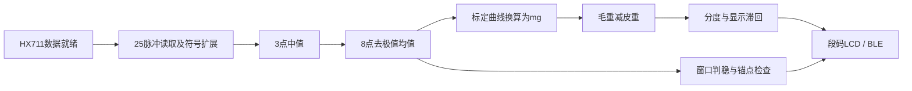

# 固件设计与软件验收 · v2.2.0

本项目以PY32F002A为主控，使用C和普冉HAL完成称重固件。采样、滤波、标定、按键菜单、显示、参数存储和通信由项目源码实现。日常操作使用SW4和HT1621段码屏，蓝牙提供可选远端入口。

## 1. 处理链路



`latest_raw`保留未经过软件滤波的有符号计数。`WeightState`保存毛重、皮重、净重、显示值、单位、稳定状态和错误状态。LCD与蓝牙读取同一份状态。

## 2. HX711读取与恢复

依据[AVIA数据手册](https://www.mouser.com/pdfdocs/HX711datasheet.pdf)，DOUT低表示转换完成；24位数据为补码，25个时钟选择下一次A通道128倍增益；10SPS建立时间400ms，PD_SCK持续高于60µs进入掉电并在拉低后复位。

本项目的实现：

- 初次启动和采样超时、坏帧、满码时，让PD_SCK保持高电平跨过两个毫秒刻度，再拉低并等待500ms；两个刻度避免刚好跨入下一毫秒就提前结束复位。
- 等待采用毫秒状态机，主循环继续喂看门狗、处理按键、提示音和通信。
- 正常读取期间只在短暂移位区间屏蔽中断，结束后恢复进入前的PRIMASK。
- 每帧检查DOUT是否释放，拒绝`0x800000`和`0x7FFFFF`饱和码。错误触发重新同步并清除旧滤波窗口。
- 菜单08第三页`rSt`显示启动及异常重同步次数；普通启动为1，发生恢复时累加。

读取采用项目自行实现的GPIO协议。`tests/host/hx711.inc`逐沿模拟DOUT，覆盖真实读取函数，检查50个交替边沿、24位正负数、饱和码、坏帧和中断恢复。该测试验证协议逻辑；物理脉冲采用8MHz时钟和NOP间隔实现。

## 3. 滤波与稳定判定

3点中值先去掉孤立尖峰，后续8点窗口去掉一个最大值和一个最小值再求均值。稳定和变化过程中使用同一滤波器，避免S切换引起均值跳变。

菜单05为0时，使用第一标定点比例换算0.2g的ADC窗口门限；正数为手动计数门限。进入S要求完整8点窗口的峰峰差达标并持续500ms。峰峰差超过2倍门限，或均值离开稳定锚点超过一个门限，退出S。

内部净重始终更新。动态阶段显示使用3/4分度滞回；进入S时按最新滤波净重取最近分度，并将屏幕与BLE共用的`display_mg`锁定。稳定净重位于±0.2g内时，锁定为0.0；正负负载都采用相同锁定流程。

锁定期间采样、判稳和毛重容量保护继续运行。峰峰差或相对稳定锚点的变化越过上述退出门限时，立即撤销锁定；S重新成立后锁住新值。去皮、取消去皮、手动归零、采样窗口清空和故障同样使输出基准重新建立。即使输出循环错过中间的不稳定帧，采样侧也已撤销旧锁定。

## 4. 标定与重量计算

Flash保存空秤计数Z、每个加载点相对Z的跨度C和对应质量M，支持1～3点，默认单点20g。相邻点必须同向递增，每段跨度至少64计数。

单点计算为`毛重mg = (滤波计数 - Z) × M × 1000 / C`。多点采用相邻分段插值；区间外使用首段或末段斜率。中间乘除使用64位整数，正反输出方向均支持。

先分别换算毛重与皮重，再计算净重，适配多点曲线。皮重、运行时归零及小范围追零保存在RAM；用户设置和完整标定记录通过双128B记录及CRC保存。

本机去皮、归零及标定的采集流程：

1. 收到按键确认后，等待松手800ms。
2. 采16个新读数，去掉最高和最低后求均值。
3. 检查峰峰差及前后8点均值的变化，不合格继续采集。
4. 20秒内仍不合格时，有新鲜数据报UnSt，无有效数据报no Ad。电池模式电源异常立即终止本次采集。
5. 标定最后一点后卸载，重新采空秤。与本轮起始零点相差不超过0.2g才提交；超限显示drFt，保留原标定。

标定在草稿中进行，提交使用独立副本。取消、漂移超限和Flash失败均保留原有效记录。

## 5. 归零、保护与调度

使用者明确确认空秤后，长按SW4手动归零可修正±100g偏移并清除皮重。自动追零只在已知零点±0.1g、原始值和滤波值均达标、稳定且无皮重时执行；持续3秒后每秒修正剩余偏差的1/4。

超过5000g按毛重进入RANGE，达到5250g进入OL，去皮后仍执行相同容量保护。默认空秤稳定且无操作120秒进入软件待机，关闭LCD、HX711、LED和电池ADC；SW4或BLE WAKE唤醒。

看门狗约4秒，调试暂停时冻结；蜂鸣器、按键和屏幕均按毫秒时间调度。21项菜单的操作见[完整指南](button-guide.md)。

## 6. 软件验收入口

```powershell
python tools/run_host_checks.py
node --test tests/web/protocol.test.mjs
pio run -e scale_py32f002a -e scale_basic -e scale_py32f002a_jlink -e scale_basic_jlink
```

| 用例 | 检查内容 |
|---|---|
| hx711.inc | 逐位读取、25脉冲、符号边界、复位建立、坏帧和超时恢复、唤醒、计时回绕 |
| stability.inc | 静态噪声、0.5g阶跃、慢加料、S退出滞回、手动门限 |
| hold.inc | 空秤/物品/负净重锁定、内部净重继续更新、0.5g解锁、慢加料、错过输出帧、去皮归零、故障与分度切换 |
| accuracy.inc | 按压偏移、新鲜16点、卸载回零、保存失败重试、取消/超时、负数计算、微小负载保留 |
| replay.inc | 117条已确认空秤的观察数据回放，大漂移保持可见并拒绝错误标定 |
| completion.inc / check.c | 21菜单、真实按键时序模拟、LCD编码、存储截断与迁移、电源告警、BLE、合成长时间调度 |
| tests/web | 分包、重试、去重、断线清理、客户端操作 |

回放数据位于`tests/fixtures/confirmed-empty-observations.csv`，只包含相对观察时间和原始计数，约4Hz；它用于数据处理和错误拒绝回归，响应时间测试使用另设的10SPS合成阶跃。

软件用例中的0.5g、20g和5000g由已知计数/克比例构造，检查换算、状态与边界。实物量程、重复性和偏载按[需求对照](../REQUIREMENTS.md)中的整机指标测量。

## 7. 代码归属与参考

业务逻辑、GPIO采样协议、整数滤波、标定状态机、按键菜单、LCD接口和测试由项目源码实现。HAL/CMSIS、社区PlatformIO平台及工具链为底层依赖，版本固定在`platformio.ini`。采样思路参考HX711_ADC和bogde/HX711，来源见[依赖说明](third-party.md)，项目不依赖Arduino HX711库。
