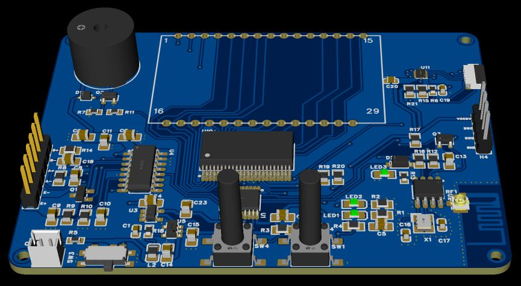

# 硬件连接与 PCB 定位

原始资料：[电子秤原理图](hardware/SCH_电子秤原理图_2026-10-29.pdf)。PCB定位和实物操作详见[操作指南](manuals/02_厨房电子秤PCB操作与联调指南_1.0.2.pdf)。



## 1. 主要器件与程序对应

| 器件 / 网络 | 主控引脚 | 程序职责 |
|---|---|---|
| U1 PY32F002AF15P6TU | VCC5V | 主控，Cortex-M0+，8MHz内部HSI |
| U4 HX711 DOUT / PD_SCK | PA0 / PA6 | ADC读取；PA6拉高使HX711掉电 |
| SW4 | PB3，按下接地 | 短按释放去皮，长按1.5秒归零 |
| SW1 | PF2-NRST | 主控复位 |
| LED2 | PB0 | 活动时每500ms翻转 |
| 蜂鸣器支路 | PA1 | 有源通断或无源约500Hz方波 |
| U2 ECB01C | PA2 TX / PA3 RX | 9600bps、8N1；FFF1 Notify / FFF2 Write |
| H4 SWD | PA13 / PA14 | SWDIO / SWCLK |
| TFT / LCD | PA4 / PB2片选 | 初始化为高，后续接显示任务 |
| TFT / LCD共享总线 | PA5时钟 / PA7数据 | 显示驱动的共用信号 |
| TFT命令数据 / LCD读信号 | PF0 / PF1 | 显示接口功能 |
| BAT-ADC | PB1 | 电池采样集成入口 |

## 2. 供电与 SWD

电源路径为电池输入 VCCBAT → SW3 后的 BAT-SW → PW5100-50 升压至 VCC5V，TLV75533 产生 VCC3V3。两针电池接口原理图1脚为VCCBAT正端、2脚为GND。按实际电池规格供电，测量主控VCC5V和3.3V支路。

### H4方向

从靠近屏幕的一端向远离屏幕的一端：

```text
屏幕端
  第1根  H4-4  VCC5V ── VREF/TVCC 参考输入
  第2根  H4-3  PA14   ── SWCLK
  第3根  H4-2  PA13   ── SWDIO
  第4根  H4-1  GND    ── GND
外侧
```

PWLINK2 Lite先在客户端设置接口电平为外部输入，应用并保存全局上电设置；断电接线，秤板自身电源供电。专用5V电源输出保持空置。VREF+5V和VDD+VDD两种外观的实际排针按设备丝印与厂家定义对应。

手册第42页的IO高电平保证值为`0.7VCC`，主控5V工作时为3.5V。输入低电平保证值上限为`0.3VCC=1.5V`。SWD信号以目标VCC为参考。[主控数据手册](https://www.puyasemi.com/download_path/数据手册/MCU%20微处理器/PY32F002A系列数据手册_V1.1.pdf#page=42)

H4提供四线接口，NRST使用板上SW1。排查连接时依次检查：目标5V、共地、参考端模式、SWCLK/SWDIO对应关系、线长与接触、USB接口识别和设备占用。记录完整下载日志；结合波形和交叉设备定位 ACK 错误。

## 3. H1称重桥路

| H1针号 | 网络 | 用途 |
|---|---|---|
| 1 | B+ | B通道正端 |
| 2 | B− | B通道负端 |
| 3 | A+ | 当前A通道信号正端 |
| 4 | A− | 当前A通道信号负端 |
| 5 | E+ | 激励正端 |
| 6 | E− | 激励负端 |

四线全桥使用E+、E−、A+、A−，按传感器资料区分线色。程序选择A通道128倍增益；原理图RATE接低，设计10SPS，联调时记录实际采样间隔。单点梁按厂家安装图固定，线束和外壳留出秤盘运动空间。

## 4. 屏幕接口

FPC1为8针0.5mm接口。下表为主板针号；屏幕排线按屏幕数据手册的触点面、1/8标记和管脚功能对应。

| FPC1 | 信号 | 信息 |
|---|---|---|
| 1 | TFT_LEDA | 背光正端，经33Ω支路接3.3V |
| 2 | GND | 地 |
| 3 | TFT_RESET | 硬件上拉复位支路 |
| 4 | TFT_RS_3V3 | 命令/数据选择 |
| 5 | TFT_SDA_3V3 | 串行数据 |
| 6 | TFT_SCL_3V3 | 串行时钟 |
| 7 | VCC3V3 | 屏幕逻辑电源 |
| 8 | TFT_CS_3V3 | 彩屏片选 |

U11 TXB0104负责3.3V/5V信号转换。段码屏驱动U10为HT1621B，段码玻璃U9为GDC0689T。显示开发需提供TFT控制器、分辨率、初始化参数和LCD SEG/COM映射，之后读取同一个`WeightState`刷新重量、单位与状态。

## 5. 电池检测

原理图检测路径是BAT-SW经10kΩ串联电阻进入BAT-ADC，节点以0.1μF对地滤波，连接MCU PB1。后续根据电池规格、ADC参考和实际电路校准电压，再建立百分比和低电门限。当前协议电量字段为-1，应用显示`--`。

## 6. 实物联调记录

记录设备编号、传感器型号、砝码质量、供电电压、软件版本、标定日期、SWD连接结果、各质量点误差/稳定时间、偏载、10次重复、10分钟空秤漂移、BLE 8小时和整机24小时结果。将记录提交到`docs/measurements/`，命名为`YYYY-MM-DD_DEVICE.md`。

官方烧录器说明：[硬件接口](https://docs.powerwriter.com/docs/faq/powerwriter/base/hardware_facility/)、[接口电平](https://docs.powerwriter.com/docs/faq/powerwriter/base/Interface_level/)。
